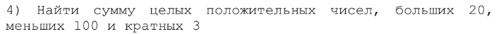

# Лабораторная работа №2.

## 1 - Постановка задачи
Используя оператор цикла, найти сумму элементов,
указанных в конкретном варианте. Результат напечатать,
снабдив соответствующим заголовком.

 ### 1.2 - Вариант 4

## 2 - Текст программы и объяснение.
>в lab2.cpp
В функции int main() объявляется переменная sum = 0 и запускается цикл for, который присваивает значения от 21 до 99 переменной i.
В теле цикла проверяется условие, которое проверяет i на кратность 3.
Если условие true, то к переменной sum прибавляется текущее значение i.
Когда i становится равным 100, условие i < 100 принимает значение false, и цикл завершается.
Сумма выводится после завершения цикла, значение 1620.

## 3 - Результат решения конкретного варианта.
Сумма целых положительных чисел, больших 20, меньих 100 и кратных 3 = 1620

