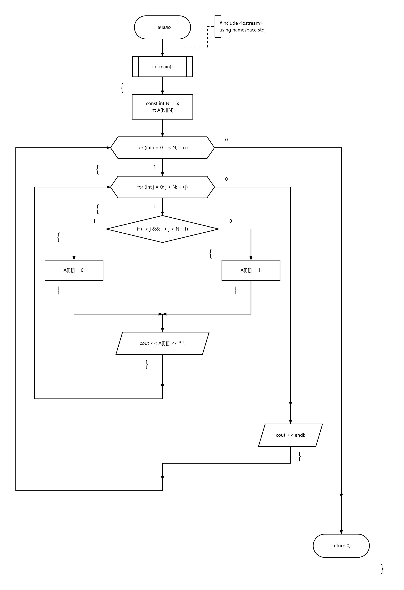

# Заполнение матрицы

Программа формирует квадратную матрицу 5 × 5. Область строго выше обеих диагоналей заполняется нулями, остальные элементы — единицами.

Для индексов от нуля условие записи нуля: `i < j && i + j < N - 1`.

## Формулы диагоналей и областей

`N` — размер квадратной матрицы, `i` — индекс строки, `j` — индекс столбца. Строки идут сверху вниз, столбцы — слева направо.

| Линия или область | Индексы от 0 до N − 1 | Номера от 1 до N |
|---|---|---|
| Главная диагональ | `i == j` | `i == j` |
| Выше главной | `i < j` | `i < j` |
| Ниже главной | `i > j` | `i > j` |
| Побочная диагональ | `i + j == N - 1` | `i + j == N + 1` |
| Выше побочной | `i + j < N - 1` | `i + j < N + 1` |
| Ниже побочной | `i + j > N - 1` | `i + j > N + 1` |

Главная диагональ идёт из левого верхнего угла в правый нижний. Побочная — из правого верхнего в левый нижний.

### Нули строго выше обеих диагоналей

В программе используются индексы с нуля. Обе проверки должны выполняться одновременно:

```cpp
if (i < j && i + j < N - 1)
    A[i][j] = 0;
else
    A[i][j] = 1;
```

Эквивалентная запись области: `i < min(j, N - 1 - j)`. Оператор `&&` означает пересечение областей — строго выше **обеих** диагоналей. На самих диагоналях остаются единицы.

Для `N = 5` нули находятся в позициях `(0,1)`, `(0,2)`, `(0,3)`, `(1,2)` при индексации с нуля.

## Результат

```text
1 0 0 0 1
1 1 0 1 1
1 1 1 1 1
1 1 1 1 1
1 1 1 1 1
```

## Материалы

- [Исходный код](matrica.cpp)
- [Блок-схема](flowchart.png)



[← Задания](../)
