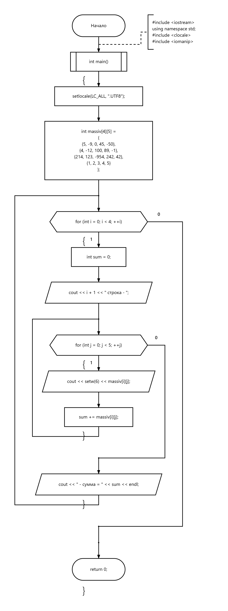

# 01 — Суммы строк матрицы

Вычисление суммы элементов каждой строки матрицы.

[Исходный код](zadanie1.cpp) · [Блок-схема](flowchart.png)

## Блок-схема

---

[← Массивы](../README.md) · [Главная](../../../README.md)
