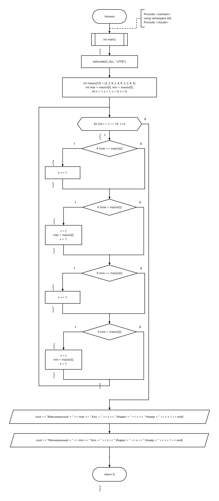

# 02 — Минимум и максимум массива

Поиск минимума и максимума, количества их вхождений и индексов первых вхождений.

[Исходный код](zadanie2.cpp) · [Блок-схема](flowchart.png)

## Блок-схема

---

[← Массивы](../README.md) · [Главная](../../../README.md)
