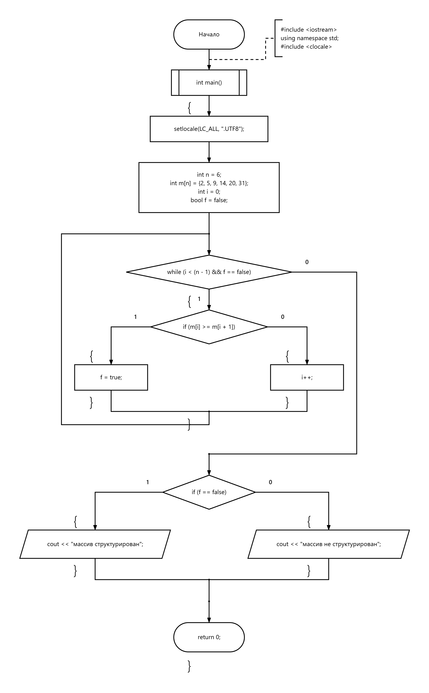

# 03 — Проверка возрастания массива

Проверка строгого возрастания элементов массива.

[Исходный код](zadanie3.cpp) · [Блок-схема](flowchart.png)

## Блок-схема

---

[← Массивы](../README.md) · [Главная](../../../README.md)
