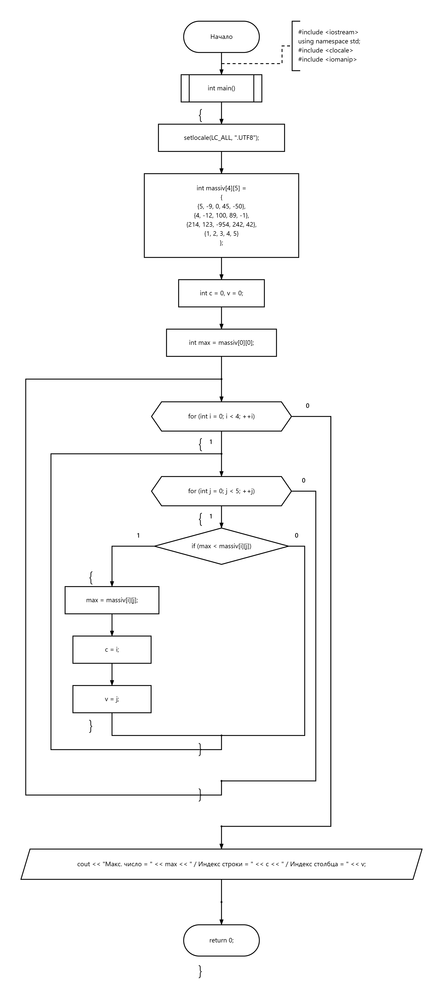

# 04 — Максимум матрицы

Поиск максимального элемента матрицы и его индексов.

[Исходный код](zadanie4.cpp) · [Блок-схема](flowchart.png)

## Блок-схема

---

[← Массивы](../README.md) · [Главная](../../../README.md)
