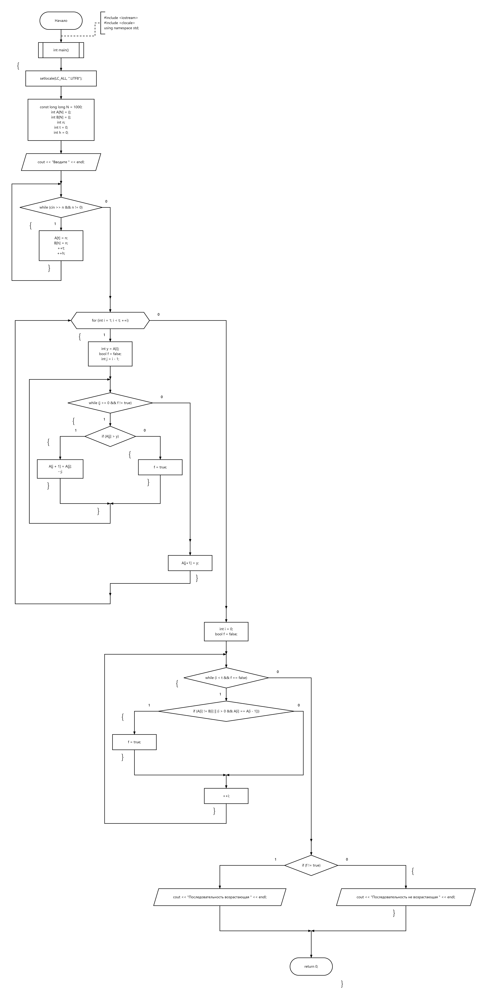

# Проверка возрастания последовательности

## Условие

Дана последовательность целых чисел. Числа вводятся до тех пор, пока не будет введён `0`. Проверить, является ли последовательность строго возрастающей. Завершающий `0` в последовательность не входит.

## Материалы

- [Исходный код](Zadanie.cpp)
- [Блок-схема](flowchart.png)

## Примеры

| Ввод | Результат |
|---|---|
| `1 2 3 0` | Возрастающая |
| `3 2 1 0` | Не возрастающая |
| `1 1 2 0` | Не возрастающая |
| `-3 -2 -1 0` | Возрастающая |

В текущей реализации массивы вмещают 1000 чисел. Проверки переполнения при вводе нет.

## Блок-схема

[← Задания](../README.md)
