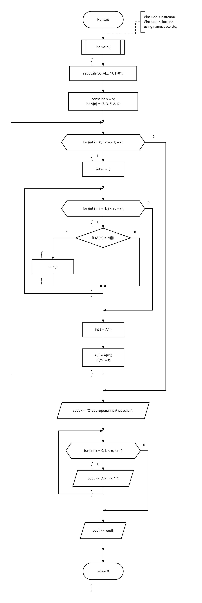

# 02 — Сортировка выбором

Сортировка целочисленного массива по возрастанию.

[Исходный код](selection_sort.cpp) · [Блок-схема](flowchart.png)

## Блок-схема

---

[← Сортировки](../README.md) · [Главная](../../../README.md)
