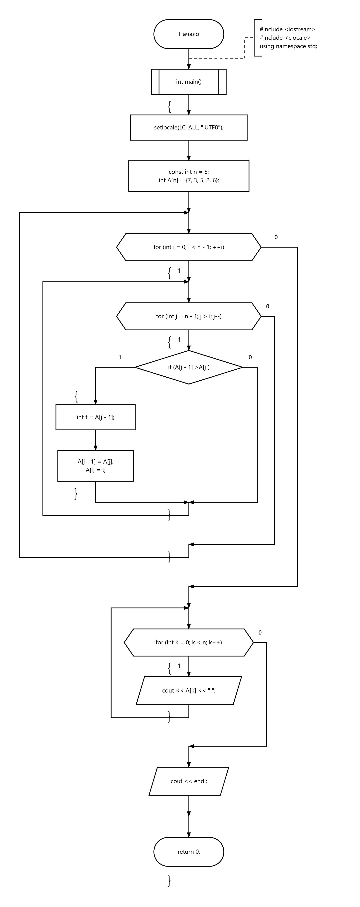

# 03 — Пузырьковая сортировка

Сортировка целочисленного массива по возрастанию.

[Исходный код](bubble_sort.cpp) · [Блок-схема](flowchart.png)

## Блок-схема

---

[← Сортировки](../README.md) · [Главная](../../../README.md)
