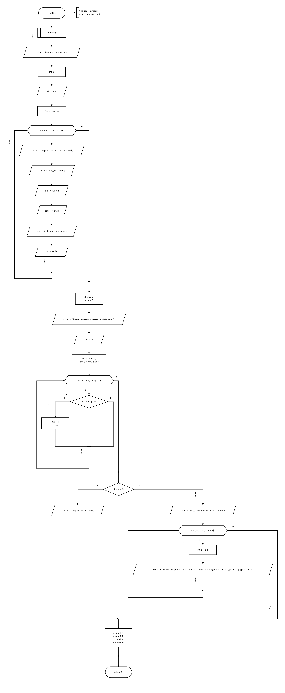

# Структуры — подбор квартир

Программа хранит цену и площадь квартир в массиве структур `F`. После ввода бюджета выводит номера, цены и площади квартир, стоимость которых не превышает бюджет.

## Материалы

- [Исходный код](main.cpp)
- [Блок-схема](flowchart.png)

## Проверка текущей версии

Сборка C++17 прошла. Проверены включение квартиры с ценой ровно по бюджету и отсутствие подходящих квартир. Компилятор предупреждает о неиспользуемой переменной `t`. Отрицательное количество квартир и нечисловой ввод не проверялись.

[← Задания](../)
