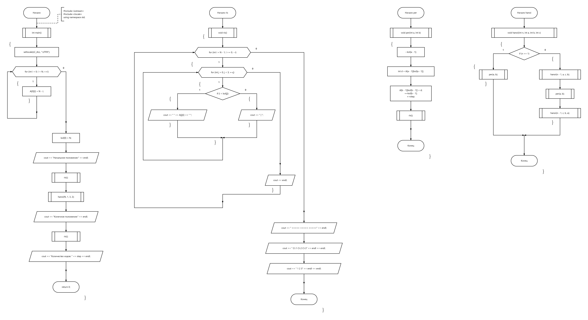

# Ханойские башни

Рекурсивное решение задачи о переносе пяти дисков с первого стержня на третий с использованием второго как вспомогательного. За один ход переносится один диск; больший диск нельзя класть на меньший.

## Реализация

- `hanoi` задаёт рекурсивный порядок переноса.
- `per` перемещает диск между стержнями.
- `ris` выводит текущее состояние башен.

Число дисков задано константой `N = 5`. Программа печатает начальное состояние и состояния после каждого из 31 хода.

## Материалы

- [Исходный код](Hanoi.cpp)
- [Блок-схема](flowchart.png)

[← Задания](../)
