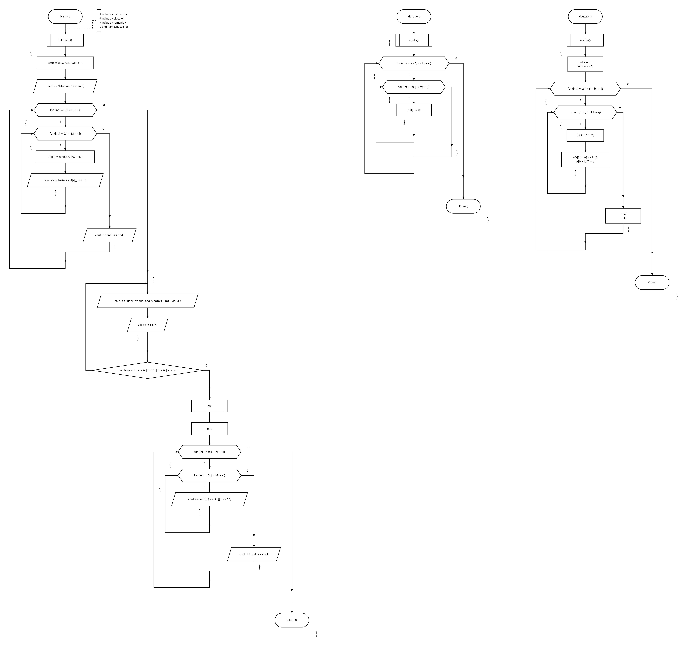
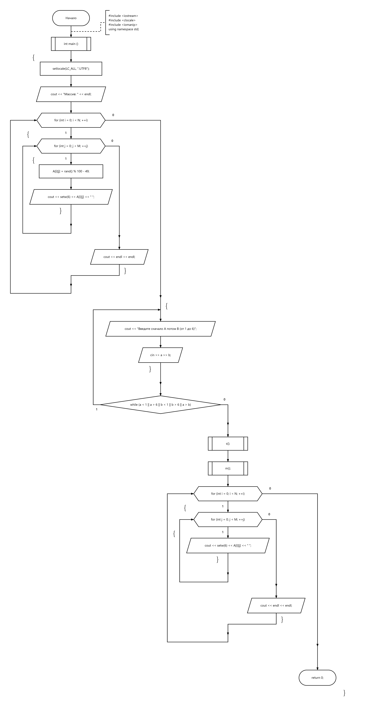

# Лабораторная работа №5 — Обработка двумерного массива

## Условие

Написать функцию для удаления строки из двумерного массива. Оставшиеся строки должны быть расположены плотно, недостающие элементы заменяются 0. С помощью разработанных функций исключить из массива строки с номерами от А до В.

## Материалы

- [Исходный код](Lab5.cpp)
- [Блок-схема 1](flowchart.png)
- [Блок-схема 2](flowchart-2.png)

## Текущая реализация

Программа формирует матрицу 6 × 5, запрашивает номера строк A и B от 1 до 6, исключает строки диапазона включительно, сдвигает оставшиеся строки и заполняет нижнюю часть матрицы нулями.

Обнуление диапазона вынесено в функцию `s()`, сдвиг строк — в функцию `m()`. Отдельная функция удаления одной строки, требуемая условием, пока не реализована.

## Проверка

Исходник собран в C++17 с `-Wall -Wextra -Wpedantic -Werror`. Проверены все 21 допустимых диапазона A…B: порядок оставшихся строк и заполнение нулями. Ошибочный нечисловой ввод отдельно не проверялся.

## Блок-схема

[← Лабораторные](../README.md)
