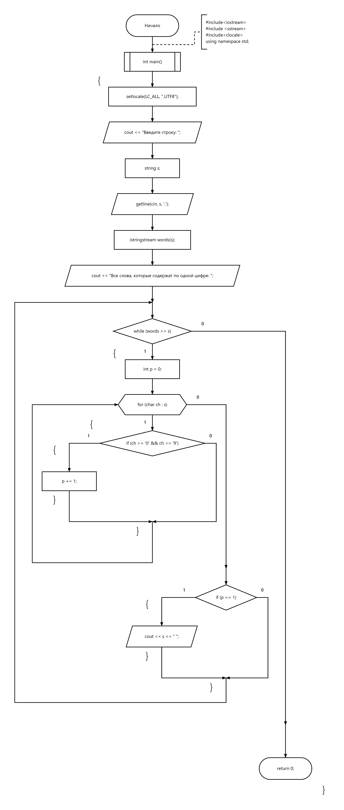

# Лабораторная работа №6 — Слова с одной цифрой

## Условие

Напечатать все слова, которые содержат по одной цифре.

## Материалы

- [Исходник](lab6_2.cpp)
- [Блок-схема](flowchart.png)

Программа читает текст до первой точки или конца ввода. Слова разделяются пробельными символами. Выводятся слова, содержащие ровно одну цифру от `0` до `9`.

Пример: `abc a1 b22 7 c0 d123.` → `a1 7 c0`.

[← Лабораторные](../README.md)
