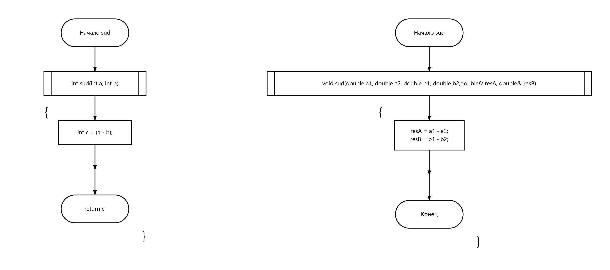
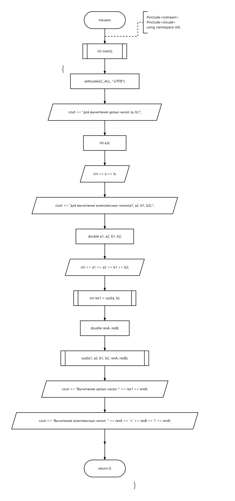
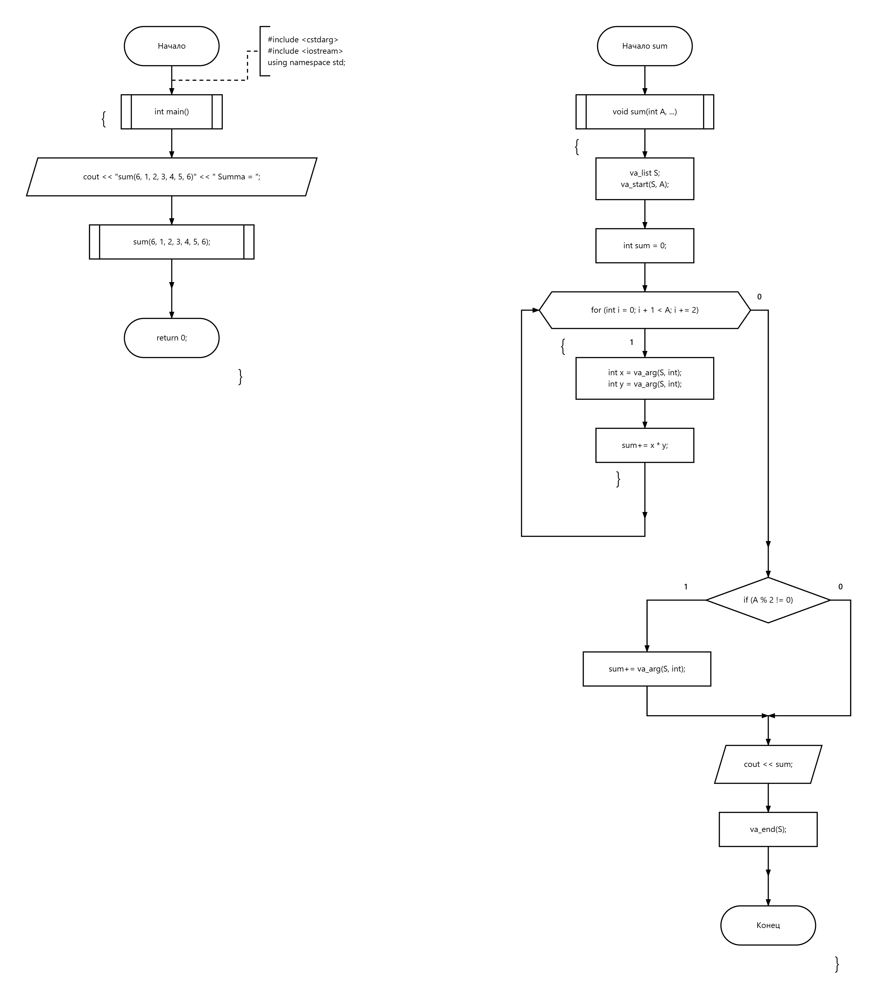

# Лабораторная работа №7 — Функции

## 7.1 — Перегрузка функций и вычитание чисел

## Описание

Перегрузка функции `sud` для вычитания целых и комплексных чисел.

- `sud(int a, int b)` возвращает разность целых чисел.
- `sud(double a1, double a2, double b1, double b2, double& resA, double& resB)` вычисляет действительную часть `a1 - a2` и мнимую часть `b1 - b2`, передавая результат по ссылкам.

Порядок ввода: сначала `a b`, затем `a1 a2 b1 b2`. Комплексные числа соответствуют парам `(a1, b1)` и `(a2, b2)`.

## Материалы

- [Исходный код](lab7_1.cpp)
- [Блок-схема 1](flowchart.png)
- [Блок-схема 2](flowchart-2.png)

## Пример

Ввод: `7 2 5 2 8 4`. Разность целых чисел: `5`, комплексных: `3+4i`.

При отрицательной мнимой части программа печатает, например, `-3+-4i` — это формат текущего вывода.

## Блок-схемы

## 7.2 — Функция с переменным числом параметров

### Условие · Вариант 4

Написать функцию `sum` с переменным числом параметров, которая находит сумму чисел типа `int` по формуле:

`S = a1*a2 + a3*a4 + a5*a6 + …`

Написать вызывающую функцию `main`, которая обращается к `sum` не менее трёх раз с количеством чисел 8, 10 и 12. Первый параметр функции задаёт количество чисел.

### Материалы

- [Исходный код 7.2](lab7_2.cpp)
- [Блок-схема 7.2](flowchart-7.2.png)

В текущем исходнике расчёт попарных произведений реализован, но в `main` пока один вызов с 6 числами. Для полного выполнения условия нужны три вызова с 8, 10 и 12 числами.

Проверенный текущий пример: `sum(6, 1, 2, 3, 4, 5, 6)` → `44`.

[← Лабораторные](../README.md)
